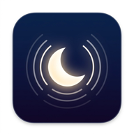

# 🌙 Sleep Noise - Bedtime White & Brown Noise PWA

A lightweight, mobile-first Progressive Web App (PWA) designed for deep, uninterrupted sleep. Plays seamless audio loops (Brown Noise, White Noise, Pink Noise, Calming Rain, and Distant Thunder) even with the mobile screen locked.



## ✨ Features

- **Single-Page Vanilla Tech Stack**: Pure HTML5, CSS3, and ES6 JavaScript. No external frameworks, zero dependencies, and minimal battery drain.
- **Native HTML5 Audio Loops**: Uses standard `<audio loop playsinline>` elements pointing to `/audio` so playback continues indefinitely when your screen is locked.
- **`navigator.mediaSession` API**: Full lock-screen and notification center controls (play, pause, multi-track dynamic titles).
- **Sound Layering & Independent Controls**:
  - Independent volume sliders (0–100%) and mute/unmute toggles for each sound.
  - Master volume slider with proportional scaling.
  - Quick mix presets: *Deep Rest*, *Rainy Night*, *Cozy Thunder*, and *White Noise*.
- **Podcast Bedtime Queue with 4-Second Crossfade**:
  - Stream episodic bedtime stories or podcasts via custom audio URLs (.mp3, .m4a) or direct RSS feeds.
  - When the podcast episode reaches its `ended` event, the player automatically begins looping your selected ambient sleep soundscape, fading volume in smoothly over 4 seconds.
  - Synchronous `navigator.mediaSession` updates transition the lock-screen metadata from podcast to ambient sounds without dropping background playback on mobile devices.
- **Sleep Timer with Smooth Fadeout**:
  - Presets: 15m, 30m, 45m, 1h, 2h, or Continuous.
  - In the final 60 seconds, volume smoothly fades to zero before stopping.
- **Bedtime Dark-Mode UI**:
  - Ultra-deep OLED black theme (`#06080d`) to prevent blue-light disruption and save battery.
  - Dedicated **Bed Dim / Night Filter** button (`🌙 Bed Dim`) for pitch-dark bedrooms.
  - High-contrast, WCAG-compliant accessible controls (≥ 4.5:1 text, ≥ 3:1 UI boundaries).
- **100% Offline PWA & HTTP Range Requests**:
  - Full `manifest.json` for standalone home screen installation on iOS and Android.
  - Custom Service Worker (`sw.js`) that pre-caches all 6 audio files on install.
  - RFC 7233 partial-content response slicing (HTTP 206) for cached audio so looping and seeking never break on iOS Safari or Android when offline.

## 🎵 Included Sounds

1. **Brown Noise**: Deep, velvety warm rumble that rolls off high frequencies for delta-wave sleep.
2. **Calming Rain**: Continuous steady rainfall on leaves and pavement.
3. **White Noise**: Crisp, even spectrum to mask sudden street sounds or barking.
4. **Pink Noise**: Balanced 1/f noise for restorative slow-wave sleep.
5. **Rain & Thunder**: Gentle rain paired with distant rolling thunder.
6. **Gentle Rain**: Soft, tranquil raindrops tapping outside.

## 🚀 Getting Started

Simply serve the directory with any static web server:

```bash
# Using Python
python -m http.server 8080

# Using Node
npx serve .
```

Open `http://localhost:8080` in your browser.

## 📱 Installing on Mobile

- **Android (Chrome)**: Tap the **Install App** button or browser menu `⋮` &rarr; **Add to Home screen**.
- **iOS (Safari)**: Tap the **Share** button &rarr; **Add to Home Screen**.
