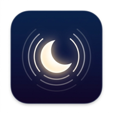

# 🌙 Sleep Noise - Bedtime Sleep Sounds & Ambient Mixer PWA

A lightweight, mobile-first Progressive Web App (PWA) designed for deep, uninterrupted sleep. Plays seamless audio loops (Calming Rain, Cozy Thunderstorm, Gentle Rain, Summer Storm, Ocean Waves, Forest Stream, Brown Noise, White Noise, and Pink Noise) with the phone screen locked.



## ✨ Features

- **Single-Page Vanilla Tech Stack**: Pure HTML5, CSS3, and ES6 JavaScript. Zero external frameworks or heavy libraries for minimal battery drain.
- **100% Seamless Continuous Hardware Looping**:
  - All sound recordings are equal-power crossfaded at their boundaries so that the end blends into the start.
  - Native hardware `loop = true` single-channel playback eliminates comb filtering, phase cancellation, and odd volume fading.
  - Operates directly in the browser's native C++ media pipeline: Android Chrome and iOS Safari play continuously with the screen locked.
- **`navigator.mediaSession` API**: Full lock-screen and notification center controls (play, pause, seek, dynamic soundscape titles).
- **Sound Layering & Independent Controls**:
  - Independent volume sliders (0–100%) and mute/unmute toggles for each of the 9 sound layers.
  - Master volume slider with proportional scaling.
  - Quick mix presets: *Deep Rest*, *Rainy Night*, *Cozy Thunder*, and *White Noise*.
- **Remembered Local MP3 / Audiobook Playback (IndexedDB)**:
  - Select any local MP3, audiobook, or sleep talk from your device.
  - The actual audio file is remembered permanently in local browser storage (`IndexedDB`) alongside your exact playback position.
  - Reopening the app or refreshing resumes directly from your saved timestamp with no need to re-pick the file.
- **Timed Sleep Transition**:
  - Listen to your local MP3 or podcast for 15 min, 30 min, 45 min, custom minutes, or until the track ends.
  - Accurately tracks progress via `<audio>` `timeupdate` events while the screen is off.
  - Primes target ambient loops during user interaction so background transition is guaranteed by mobile autoplay policies.
  - Smoothly crossfades over 5 seconds (`Math.cos` / `Math.sin`) from primary audio into continuous ambient sleep sounds and saves your position.
- **Sleep Timer with Smooth Fadeout**:
  - Presets: 15m, 30m, 45m, 1h, 2h, or Continuous.
  - In the final 60 seconds, volume smoothly fades to zero before stopping.
- **Bedtime Dark-Mode UI**:
  - Ultra-deep OLED black theme (`#06080d`) to prevent blue-light disruption and save battery.
  - Dedicated **Bed Dim / Night Filter** button (`🌙 Bed Dim`) for pitch-dark bedrooms.
  - High-contrast, WCAG-compliant accessible controls (≥ 4.5:1 text, ≥ 3:1 UI boundaries).
- **100% Offline PWA & HTTP Range Requests**:
  - Full `manifest.json` for standalone home screen installation on iOS and Android.
  - Custom Service Worker (`sw.js`) that pre-caches all 9 audio files on install.
  - RFC 7233 partial-content response slicing (HTTP 206) for cached audio so looping and seeking never break on iOS Safari or Android when offline.

## 🎵 Included Sounds

1. **Calming Rain**: Continuous soothing rainfall loop on leaves and pavement.
2. **Cozy Thunderstorm**: Steady rainfall with rolling distant thunder.
3. **Gentle Rain**: Soft peaceful raindrops tapping outside.
4. **Summer Storm**: Gentle summer rain with distant rumbling thunder.
5. **Ocean Waves**: Rhythmic gentle waves washing ashore.
6. **Forest Stream**: Bubbling mountain brook flowing over stones.
7. **Brown Noise**: Deep warm rumble for restorative delta-wave sleep.
8. **White Noise**: Crisp, even spectrum to mask sudden background noises.
9. **Pink Noise**: Balanced 1/f noise for restorative slow-wave sleep.

## 🚀 Getting Started

Simply serve the directory with any static web server:

```bash
# Using Python
python -m http.server 8080

# Using Node
npx serve .
```

Open `http://localhost:8080` in your browser.

## 📱 Installing on Mobile

- **Android (Chrome)**: Tap the **Install App** button or browser menu `⋮` &rarr; **Add to Home screen**.
- **iOS (Safari)**: Tap the **Share** button &rarr; **Add to Home Screen**.
